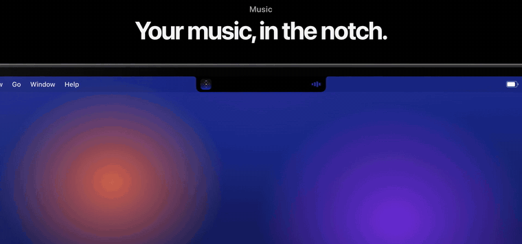
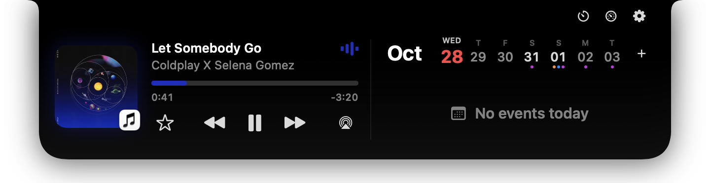
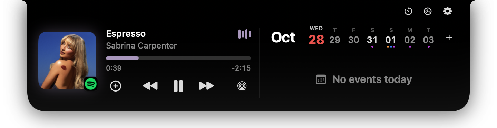
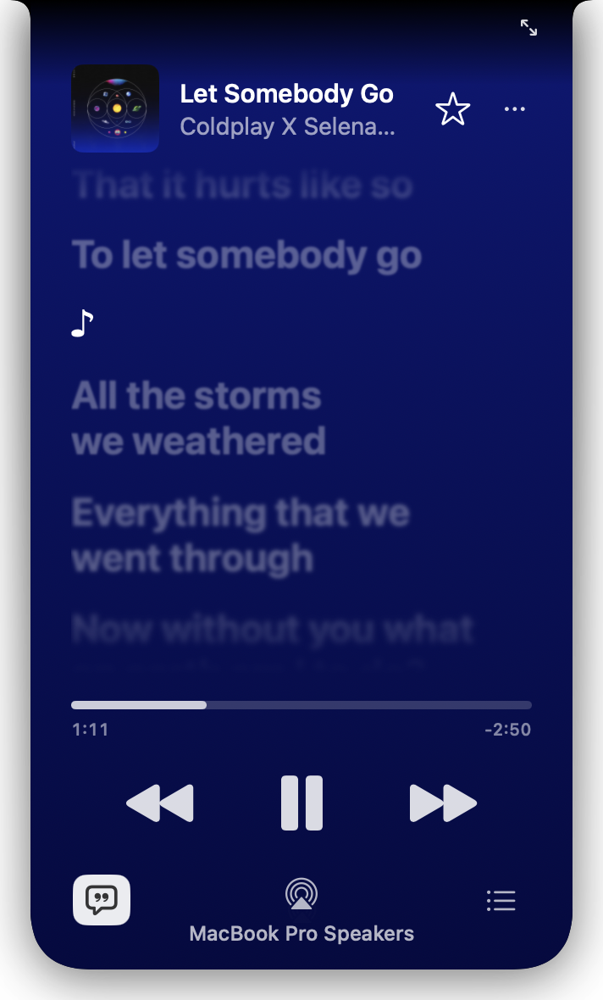
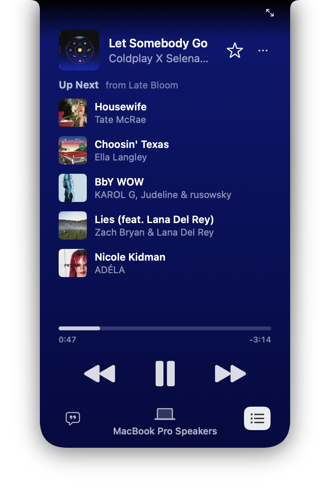
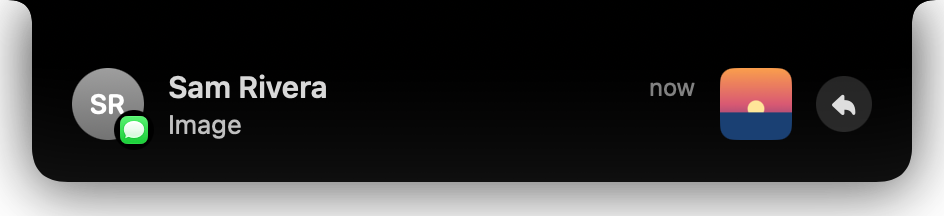
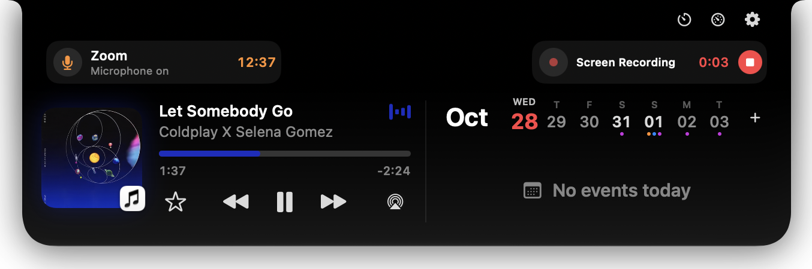
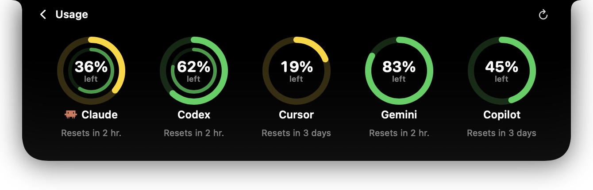
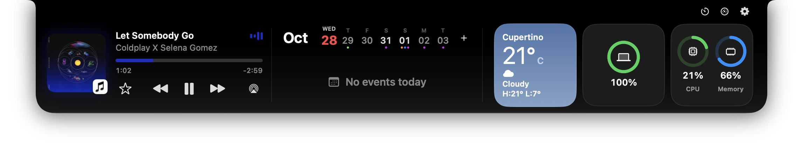
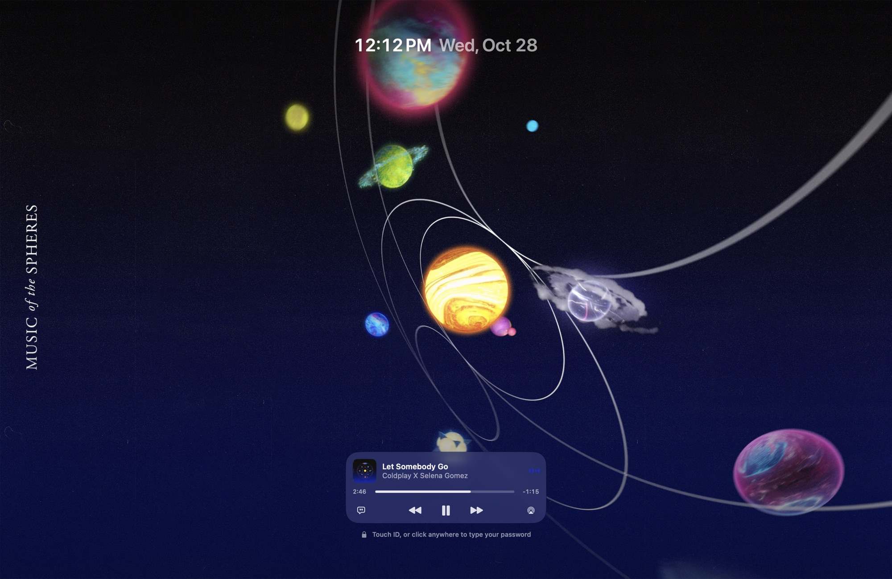

<h1 align="center">Oriel 3.0</h1>

Your notch has a lot more to say. A free Dynamic Island for your Mac: your music on Apple Music or Spotify, lyrics and moving covers, live activities, texts and calls, your week, widgets and even your lock screen.

<a href="../../releases/latest/download/Oriel.dmg"><b>Download Oriel 3.0</b></a> · <a href="https://orielformac.pages.dev">Website</a> · <a href="https://buymeacoffee.com/orielapp">☕ Buy me a coffee</a>

### Apple Music or Spotify, all the way
Save songs and add them to playlists without switching apps, see which playlists have a song, synced lyrics, up next, a full-screen cover and music on the lock screen. On Spotify, see which device it's playing on and move it back to your Mac.

  
  

  
  
  

### Everything that's happening, live
Calls with Answer and Decline, Zoom, Teams and Meet with mute and leave, texts with photos and quick replies, Claude Code and Codex step by step, AI usage limits, timers, downloads, screen recordings, charging and AirPods.

  
  

  
  

### Your week, files and widgets
Add events by typing, drop files in the notch, and add widgets from the gallery or make your own.

## Install
Download **Oriel.dmg** from the [latest release](../../releases/latest), drag Oriel to Applications and open it. The first time, go to **System Settings → Privacy & Security → Open Anyway**. Needs macOS 14 or newer, on Apple Silicon or Intel, with or without a notch.

Oriel checks this feed and offers new versions right in the app. No ads, no account, no tracking.

Ideas, bugs or questions? Email **[orielformac@gmail.com](mailto:orielformac@gmail.com)**. If you enjoy Oriel, you can [buy me a coffee](https://buymeacoffee.com/orielapp) ☕
